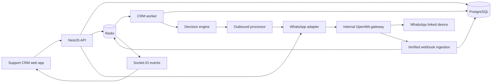

# System Architecture

## Runtime and boundaries

The diagram describes the existing modular monolith. It does not claim additional channel adapters or tenant boundaries exist.

## Important paths

**Account connection:** browser → `whatsapp.connect` → authenticated account endpoint → channel service/adapter → gateway session → QR response/event → browser QR rendering → phone scan → provider connection event/refetch → connected account presentation. The account page stays inside the web app throughout.

**Inbound:** adapter-verifiable webhook → provider-event deduplication/persistence → incoming queue → normalization/classification → message/conversation persistence → decision processing → optional outbound work. Unknown identities are not automatically confirmed customers.

**Outbound:** operator or decision → persisted outbound request with source/idempotency key → worker → account/capability/ownership/control/rate checks → adapter send → normalized delivery updates. A queued send and an acknowledged delivery remain distinct states.

**Knowledge:** document/article → background parsing/chunking/indexing → verified knowledge retrieval → policy-controlled AI decision → answer or human handover.

**Workspace operations:** authenticated endpoints → transactional billing/term/schedule/leave/release persistence → audit; selected actions create owner-scoped in-app notifications. See the earlier release report for business invariants.

## Frontend organization

- `app.tsx`: authentication gate, routing and application shell.
- `navigation.tsx`: available navigation destinations, permission metadata and section labels.
- `components/workspace-shell.tsx`: reusable navigation, page finder and mobile drawer behavior.
- `components/ui.tsx`: page headings, cards, empty/error/loading states, tables, stats, charts and feedback.
- `theme.css`: authoritative brand, semantic and light/dark tokens.
- `design-system.css`: consistent presentation for shell, pages, dialogs, forms, inbox and login.
- `pages/`: business screens; `api/client.ts` and `api/workspace.ts`: typed API access.

## Isolation and future change

API and worker share entities/migrations but run separately. Multiple WhatsApp accounts are isolated by account IDs and adapter ownership; existing business tables remain workspace-global. Multi-project support needs a separate coordinated schema, permission, query and queue namespace migration. Do not simulate it with a dropdown.
